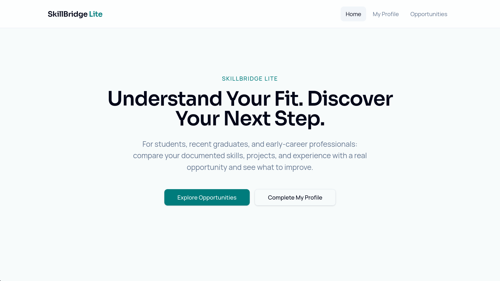
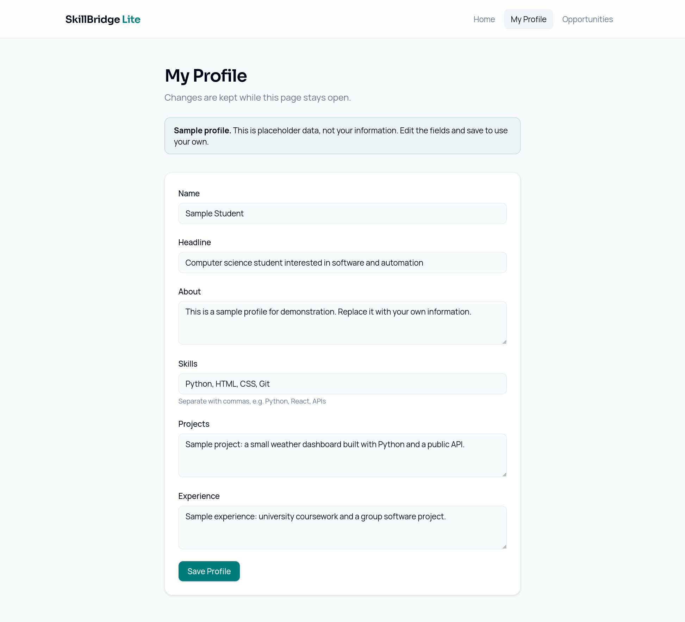
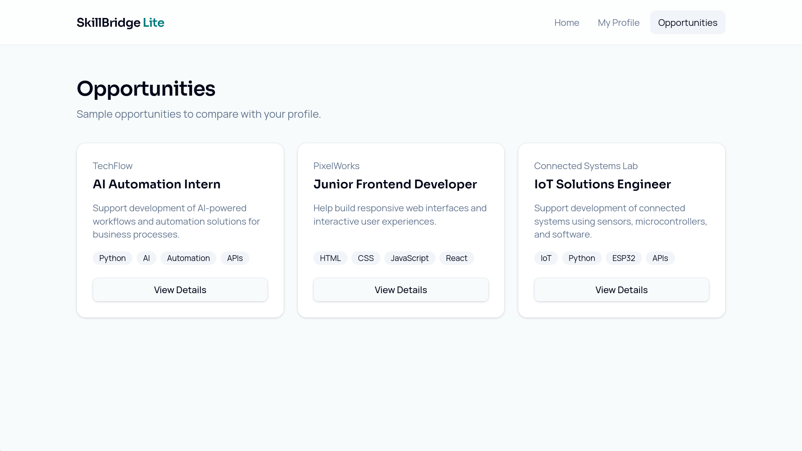
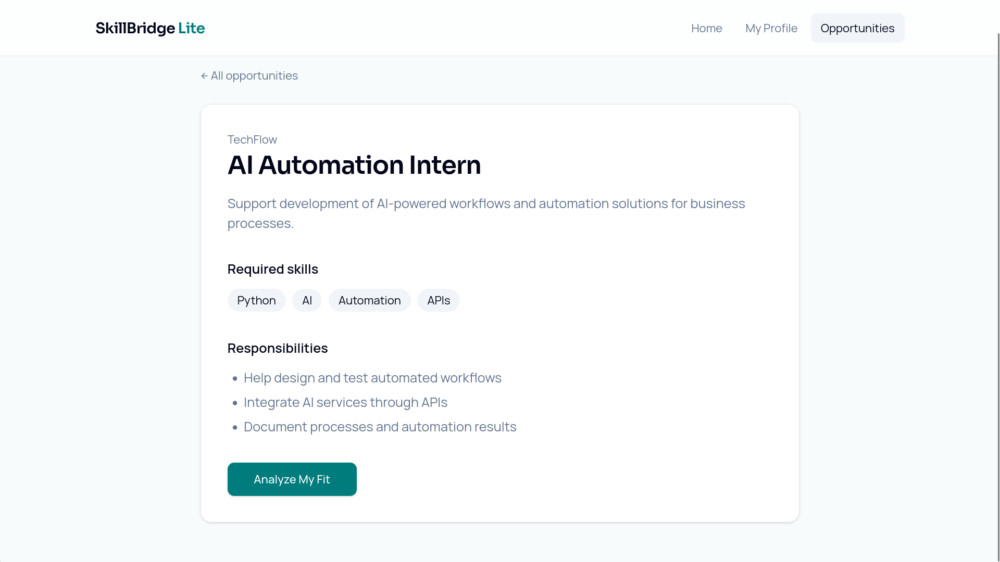
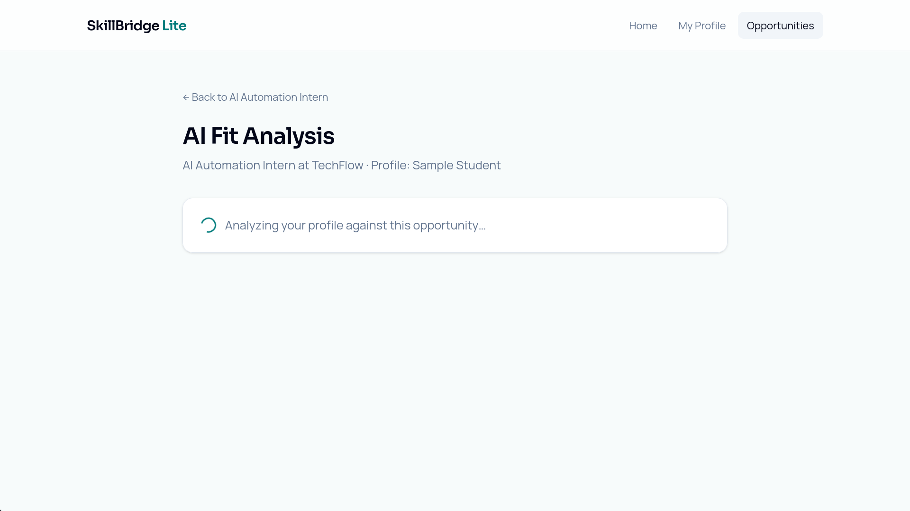
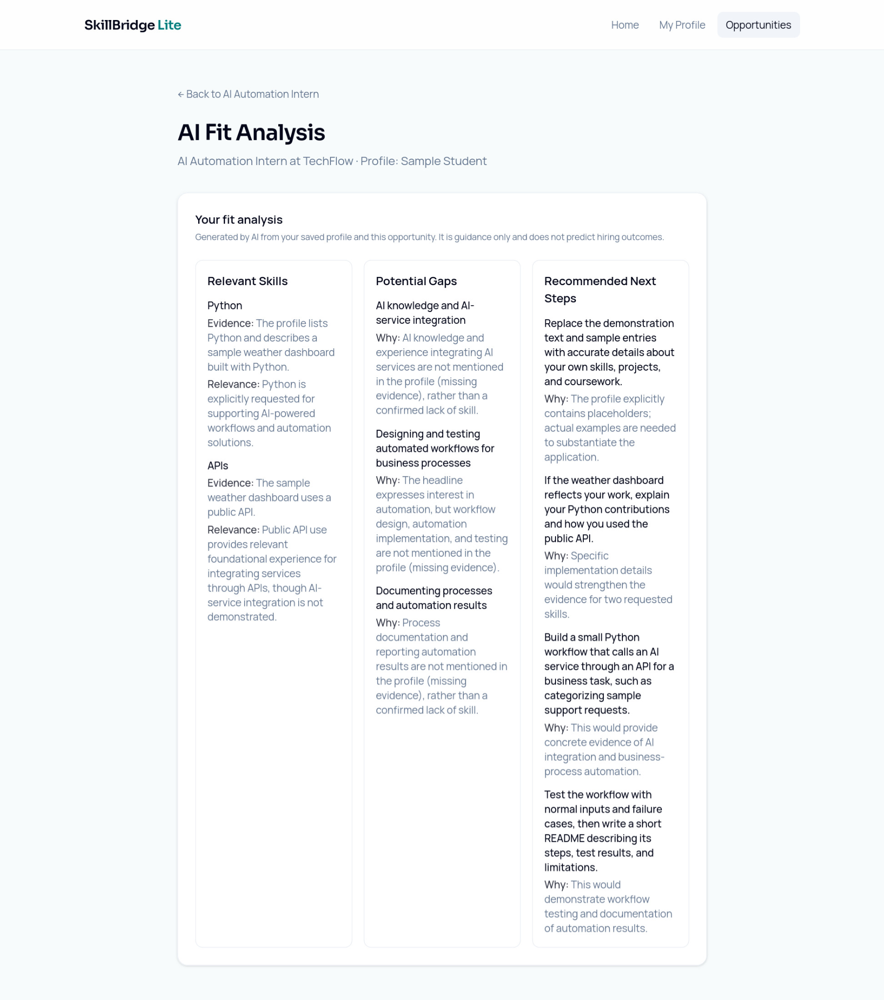

# SkillBridge Lite

**Understand Your Fit. Discover Your Next Step.**

SkillBridge Lite is an AI-assisted career guidance prototype for students, recent graduates, and early-career professionals. It compares a profile's documented skills, projects, and experience with a sample opportunity, then presents relevant skills, potential gaps, and recommended next steps.

[Live Demo](https://skillbridgelite.lovable.app) · [Project Repository](https://github.com/WeaamR/skillbridge-lite-weaam)

## Why this project

Reading an opportunity's requirements does not always make it clear which parts of a profile demonstrate a match or what evidence is missing. SkillBridge Lite makes that comparison explicit and helps users identify practical improvements to their profile and project experience.

The result is guidance for the user. It does not predict hiring outcomes, rank applicants, or establish whether a person is qualified for employment.

## Features demonstrated

- **Editable profile:** name, headline, about, skills, projects, and experience.
- **Clear sample data:** a notice identifies the default profile as placeholder information.
- **Opportunity browsing:** cards show the organization, role, description, and required skill tags.
- **Opportunity details:** a dedicated view lists requirements and responsibilities.
- **Analysis loading state:** visible feedback while an analysis is being prepared.
- **Evidence-based explanations:** relevant skills include supporting profile evidence and their relevance to the selected opportunity.
- **Potential gaps:** explanations identify missing evidence without automatically treating it as a confirmed lack of skill.
- **Practical next steps:** suggestions include reasons tied to the profile and opportunity.

## Screenshots and user journey

### 1. Start from the homepage

The homepage explains the product and offers two starting points: **Explore Opportunities** and **Complete My Profile**.

The homepage screenshot appears above.

### 2. Complete a profile

Users can edit six fields and select **Save Profile**. Skills are entered as comma-separated values. The demonstration clearly labels the initial data as a sample profile.

The page states that changes are kept while the page stays open. This documentation does not claim permanent database storage or cross-device synchronization.

View the profile screen

### 3. Browse sample opportunities

The supplied screen contains three sample roles:

| Role | Organization shown | Skill tags |
| --- | --- | --- |
| AI Automation Intern | TechFlow | Python, AI, Automation, APIs |
| Junior Frontend Developer | PixelWorks | HTML, CSS, JavaScript, React |
| IoT Solutions Engineer | Connected Systems Lab | IoT, Python, ESP32, APIs |

These are identified in the interface as sample opportunities, not verified live vacancies.

### 4. Review an opportunity

The **AI Automation Intern** detail screen lists Python, AI, Automation, and APIs as required skills. Responsibilities include designing and testing workflows, integrating AI services through APIs, and documenting processes and results.

Selecting **Analyze My Fit** starts the profile comparison flow.

### 5. Follow the loading state

The analysis page identifies the selected role and profile, then displays a spinner and the message: **Analyzing your profile against this opportunity...**

### 6. Review the result

The result is organized into three columns: **Relevant Skills**, **Potential Gaps**, and **Recommended Next Steps**. A notice explains that it is guidance only and does not predict hiring outcomes.

View the complete analysis result

## Documented example

The supplied screenshots compare **Sample Student** with **AI Automation Intern at TechFlow**.

| Result area | Example from the displayed analysis |
| --- | --- |
| Relevant skill | Python, supported by the listed skill and sample weather-dashboard project. |
| Relevant skill | APIs, supported by the project's use of a public API. |
| Potential gap | AI knowledge and AI-service integration are not documented in the profile. |
| Potential gap | Workflow design, implementation, and testing are not documented. |
| Potential gap | Process documentation and automation reporting are not documented. |
| Next step | Replace placeholder entries with accurate personal details and project evidence. |
| Next step | Explain the Python contribution and public API usage in the project. |
| Next step | Build and test a small AI-integrated workflow and document it in a README. |

The output specifically distinguishes **missing evidence** from a **confirmed lack of skill**. For example, using a public API is described as foundational experience; it is not presented as proof of AI-service integration.

The screenshot documents one displayed analysis, not measured accuracy across multiple profiles or opportunities.

## How to try it

1. Open the [live demo](https://skillbridgelite.lovable.app).
2. Visit **My Profile** and replace the sample entries with an accurate profile.
3. Select **Save Profile**.
4. Open **Opportunities** and choose **View Details** for a sample role.
5. Select **Analyze My Fit**.
6. Review the evidence, potential gaps, and suggested improvements.

The default sample profile can also be used to explore the demonstration without entering personal details.

## Profile inputs and analysis outputs

| Input | Purpose |
| --- | --- |
| Name | Identify the profile being compared. |
| Headline | Summarize the user's current focus. |
| About | Provide background and interests. |
| Skills | List claimed skills in comma-separated form. |
| Projects | Supply examples of applied work. |
| Experience | Describe relevant coursework, work, or activities. |

| Output | What the interface shows |
| --- | --- |
| Relevant Skills | Skill, evidence from the profile, and relevance to the role. |
| Potential Gaps | Requirement or responsibility and an explanation of missing evidence. |
| Recommended Next Steps | Practical action and an explanation of why it would help. |

## Implementation and review scope

This documentation is grounded in six supplied screenshots covering the homepage, profile, opportunity list, opportunity details, loading state, and completed result.

The project repository could not be retrieved during preparation. The source code, backend configuration, and any model integration were therefore not inspected. Frameworks, model providers, prompt design, output validation, persistence mechanisms, and local installation commands are intentionally left unspecified until the code is available.

The visible interface calls the result AI-generated; the screenshots do not independently establish the underlying generation implementation. No new analysis was run during documentation preparation.

## Future documentation and validation

- Add verified installation and deployment instructions from the repository's actual configuration.
- Document the analysis provider, prompt, and response contract.
- Confirm how profiles are stored and when they are cleared.
- Test incomplete profiles, unavailable opportunities, and analysis failures.
- Add mobile screenshots and verify responsive behavior.
- Evaluate explanation quality across multiple profile-and-opportunity pairs.

## العربية

**SkillBridge Lite** نموذج أولي للإرشاد المهني يساعد الطلاب والخريجين وحديثي الخبرة على مقارنة المهارات والمشاريع والخبرات المكتوبة في ملفهم مع متطلبات فرصة تجريبية.

يعرض التحليل المهارات ذات الصلة مع دليلها، والفجوات المحتملة، وخطوات عملية مقترحة للتحسين. يوضح المثال الفرق بين غياب توثيق المهارة وعدم امتلاكها، ويؤكد أن النتيجة إرشادية ولا تتنبأ بقرار التوظيف.

يشمل التوثيق الصور الست التي توضح رحلة الاستخدام كاملة. تفاصيل التقنيات وأوامر التشغيل تحتاج مراجعة الكود، إذ تعذّر استرجاع المستودع أثناء إعداد هذه النسخة.
